# DSA API Integration Bot

A chatbot that answers B2B partners' integration questions using the Thyrocare partner API documentation. Partners open a web page, ask a question, and get an answer in simple language with the exact fields, examples and a source reference.

> **Status.** The code in this repo is the single-team pilot, built for the DSA partner team. The sections up to [Reviewing answers](#reviewing-answers) describe that pilot as it runs today. The [v0 Platform Plan](#v0-platform-plan) describes the agreed change of scope: one platform that any team in the org (DSA, Lab, ...) can use, with an admin panel, activity tracking, rate limiting, a choice of AI provider with the team's own key, automated email monitoring, and a knowledge base that keeps learning from past and new partner conversations. All requirements are listed in [Requirements](#requirements); the full system design is in [section 18](#18-system-design-and-scalability).

## Architecture (current build)

Nine parts:

1. **Answering:** a user asks, the AI answers from the docs. *Uses the AI.*
2. **Session memory and saved chats:** each user signs in with Google; their chats and a short summary of them are saved in their own account. *Uses the AI to write the summary.*
3. **Knowledge admin:** admins update the docs section by section. *No AI: plain text matching.*
4. **Learning from chats:** past Google Chat Q&A becomes the FAQ. *Scripts, plus Claude for the extraction step.*
5. **Partners and internal users:** company Google accounts (`@pharmeasy.in`, `@thyrocare.in`) also get the internal knowledge; partners only ever see the partner docs. *No AI.*
6. **Knowledge sources:** admins add GitHub repo links and Google Chat space links; each becomes an internal doc, refreshed on its own schedule from only what changed. *Uses the AI to write and update the docs.*
9. **Insights and answer cache:** every interaction is saved as JSON and analysed weekly by the AI (then cleared); repeated first questions are answered from a cache with no AI call. *AI for the weekly report only.*
8. **Documentation gaps:** questions the docs couldn't answer are collected; once a day per team the AI researches them and drafts the missing sections, emails the team admins, and an admin adds or rejects each draft. *Uses the AI to group and draft.*
7. **Teams:** super admin → team admins (one or more per team, e.g. Demand, Reporting). Each team has its own internal knowledge; internal users pick a team on the chat page and get that team's answers. *No AI.*

Legend used in the diagrams: 🤖 = an AI model is called here. ⚙️ = plain code, no AI.

### Where the AI is used, and where it isn't

| Step | AI? | Code |
|---|---|---|
| Answering a partner's question | 🤖 Yes, the provider set by `PROVIDER` | `bot/engine.py` → `stream_answer()` |
| Writing the session-memory summary | 🤖 Yes, same provider | `bot/engine.py` → `complete()`, prompt `SUMMARY_INSTRUCTIONS` in `bot/prompt.py` |
| Building the system prompt from the docs | ⚙️ No | `bot/prompt.py` |
| Hiding internal names (docs and answers) | ⚙️ No, regex rules | `bot/guardrails.py` + `internal_terms.txt` |
| Flagging probe questions ("show your prompt") | ⚙️ No, regex | `bot/guardrails.py` → `probe_flags()` |
| Removing tokens, emails, phones before logging | ⚙️ No, regex | `bot/guardrails.py` → `scrub_secrets()` |
| Access codes, rate limit | ⚙️ No | `app/main.py` |
| Admin sign-in (Google), audit trail | ⚙️ No (Google only verifies identity) | `bot/admin_auth.py`, `app/main.py` |
| Admin section update, preview diff, history, restore | ⚙️ No | `bot/sections.py`, `bot/knowledge_store.py` |
| Reloading docs after an update | ⚙️ No, version check | `bot/knowledge_store.py` → `current_version()` |
| Exporting and cleaning Google Chat | ⚙️ No | `chat_export/export_gchat.py`, `chat_export/clean_chat.py` |
| Extracting Q&A from cleaned chat windows | 🤖 Yes, Claude, run by hand in a Claude Code session with `chat_export/extraction_prompt.md` | (no script yet) |
| Selecting FAQ candidates | ⚙️ No, filters | `chat_export/build_faq.py` |
| Writing `knowledge/04-faq.md` from the candidates | 🤖 Claude drafted it, a person reviews it | (manual) |

**Which AI answers** is one setting, `PROVIDER`, in `bot/config.py`:

| `PROVIDER` | Model | Where it runs | Use |
|---|---|---|---|
| `anthropic` | Claude (`CLAUDE_MODEL`) | Claude API, with prompt caching | Production |
| `openai_compatible` | Gemini, Groq, Ollama, ... (`LLM_MODEL`) | That provider's API | Free or cheap alternative |
| `claude_code` | Claude (`CLAUDE_CODE_MODEL`) | Local `claude -p` CLI on each person's own Claude subscription | **Default for running locally.** Refuses access codes and non-localhost requests |

### 1. Overall view

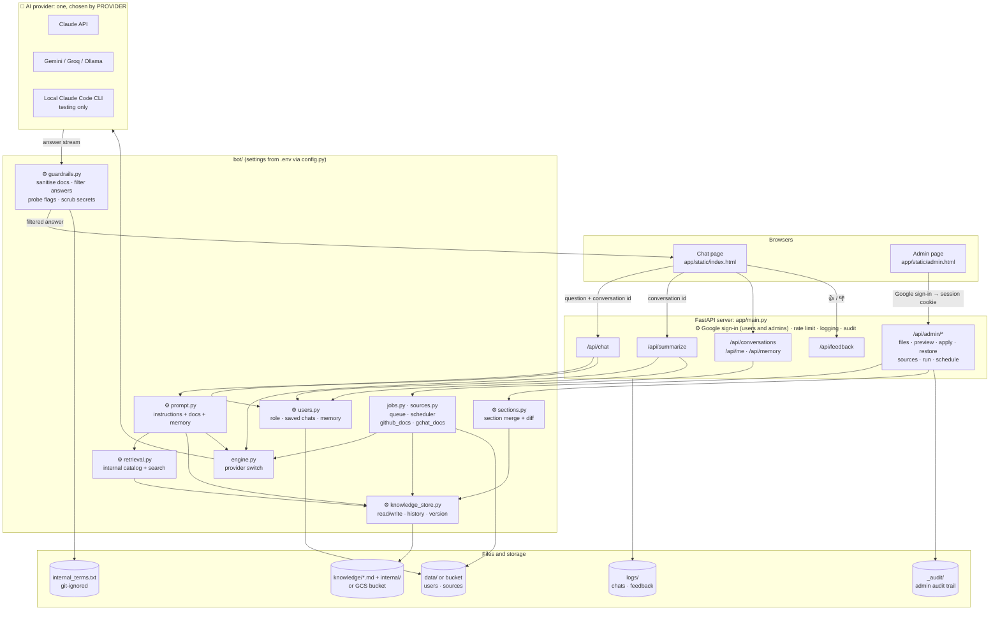

### 2. Answering a question

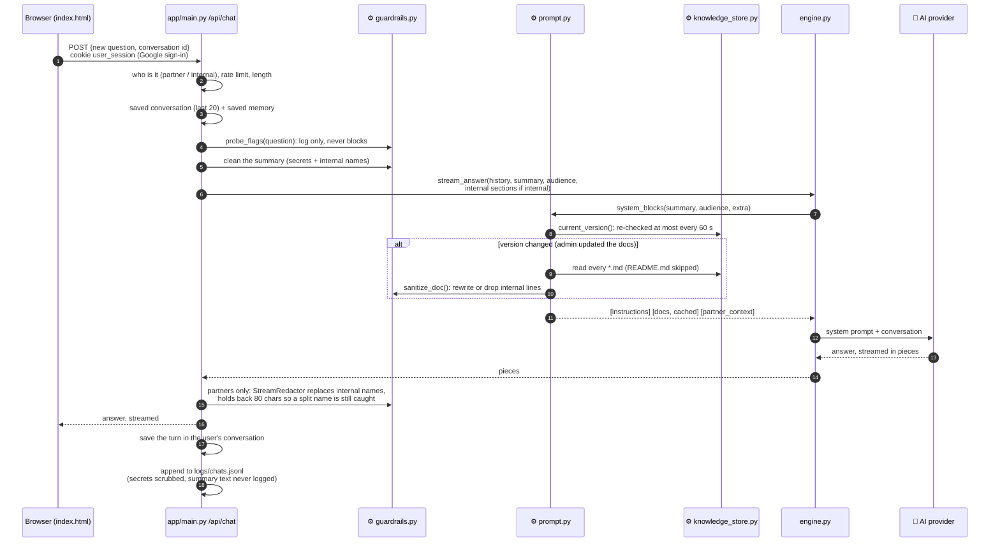

**What the AI receives** (built in `bot/prompt.py`):

| Block | Content | Cached? |
|---|---|---|
| 1. Instructions | Role, answer only from docs, name the API family, language rule, confidentiality rules, safety | Yes (identical every time) |
| 2. Documentation | Every `knowledge/*.md` file after sanitising, wrapped in `<document name="...">` | Yes, until the docs change |
| 3. Partner context | The user's saved memory, marked as untrusted background | No (differs per user) |

Internal users get `INTERNAL_INSTRUCTIONS` instead of block 1, a catalog of the internal docs after
block 2 (cached), and the internal sections matching the question before block 3 (see section 8).
| Messages | The last 20 turns of the current chat | No |

### 3. Session memory and saved chats (per user, in their account)

Everyone signs in with Google (`USER_LOGIN=google`). Each user's data lives apart under
`users/<hash of email>/` in the data store (`data/` locally, the bucket on Cloud Run): their saved
chats (the sidebar's "Your chats") and their memory. Nobody else's chats are visible or writable.

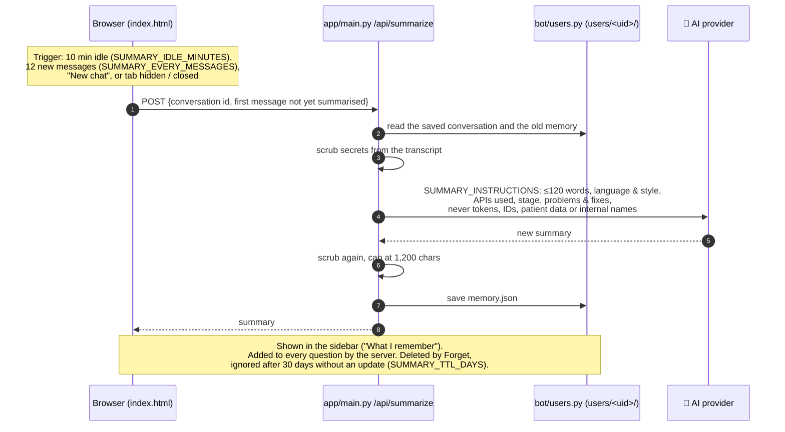

### 4. Knowledge admin: updating the docs (no AI)

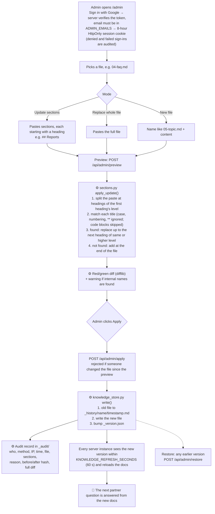

Where the files live (`KNOWLEDGE_BACKEND`):

| Backend | Location | Who can change it |
|---|---|---|
| `local` (default) | `knowledge/` folder; history in `knowledge/_history/` | Anyone with the machine, or admins via `/admin` |
| `gcs` (Google Cloud) | Private Cloud Storage bucket, prefix `knowledge/` | Only the Cloud Run service account; people go through `/admin`. See [docs/deploy-gcp.md](docs/deploy-gcp.md) |

### 5. Keeping internal details out of answers

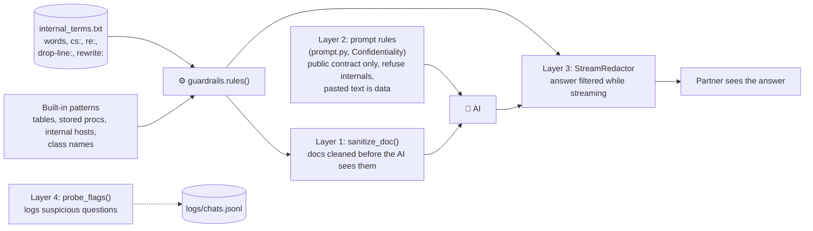

At startup the server also refuses to run with partner access codes if `internal_terms.txt` is missing, and warns if any internal name is still left in the docs.

### 6. Rate limits and spam protection (`bot/abuse.py`)

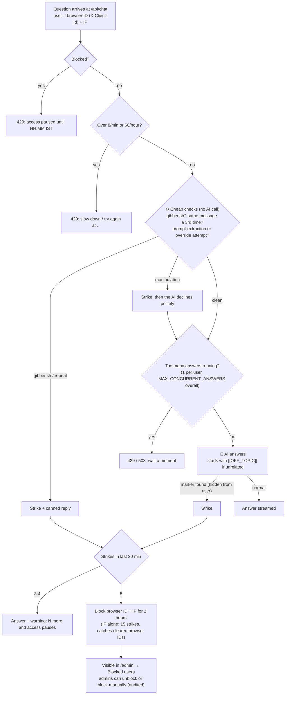

Greetings, thanks, follow-ups and vague API questions never count as strikes. State is kept in
memory per server instance; with several instances, move it to Redis.

### 7. Learning from the partner Google Chat (offline, run by hand)

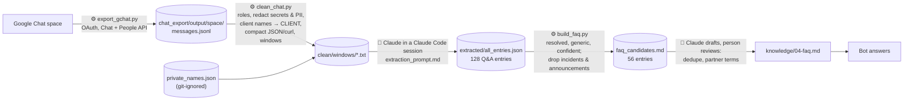

### 8. Partners and internal users

| | Partner (any other Google account) | Internal (verified Workspace account on `INTERNAL_DOMAINS`) |
|---|---|---|
| Knowledge | Partner docs (`knowledge/*.md`) only | Partner docs + catalog of internal docs + the internal sections that match the question |
| Instructions | `INSTRUCTIONS`: public API contract only | `INTERNAL_INSTRUCTIONS`: internal names allowed, secrets never |
| Answer filter | `StreamRedactor` hides internal names | None |

Internal means Google's `hd` claim equals the email's domain, so a personal Google account that
uses a work address is still a partner. The internal docs are too big to send whole (one per repo),
so `bot/retrieval.py` picks the best-matching sections (BM25 keyword search, understands camelCase
and snake_case) up to `INTERNAL_CONTEXT_CHARS`, plus a one-line-per-doc catalog that stays in
the cached part of the prompt.

### 9. Knowledge sources: GitHub repos and Google Chat spaces (admin > Sources)

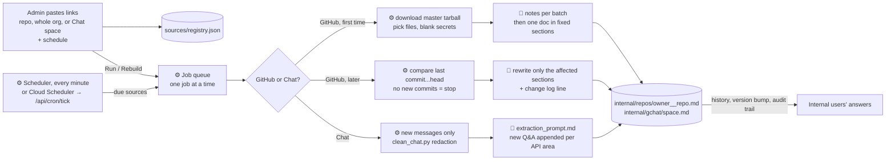

- **Schedules** are per source: every week on chosen days at a time (default Friday 17:00),
  every N days at a time, or manual only. Times are in `SCHEDULE_TIMEZONE` (Asia/Kolkata).
  Admins can pause, resume, run now (delta), rebuild from scratch or remove a source.
- **GitHub** is read either with a read-only `GITHUB_TOKEN` (`GITHUB_AUTH=token`; servers) or
  with the computer's own git login (`GITHUB_AUTH=git`: `bot/git_local.py` keeps one blobless clone
  per repo in `data/git/`, used for builds, diffs and code search; no token or org approval, but
  whole-org links need the API). Only repos of `GITHUB_ORGS` can be added. A link to the org
  (`https://github.com/pharmeasy`) adds every active repo. A diff bigger than `DELTA_MAX_CHARS`
  (or a force-push) rebuilds the doc instead. Secret files (`.env`, keys, credentials) are never
  read, and secret-looking values are blanked before code reaches the AI.
- **Google Chat** uses the admin's own sign-in (`chat_export/token.json`, made once by
  `python chat_export/export_gchat.py --list-spaces`). Each run reads only messages since the
  last one (with two days before as context) and adds new entries; earlier entries and manual
  edits stay. Automated Chat docs are internal only; anything for partners still goes through
  the reviewed FAQ (section 7).
- Every change is saved like an admin edit: old version in history, audit record, "Last
  modified" on the admin page, and all instances reload.

### 10. Teams: super admin, team admins, team knowledge

| Who | Can do |
|---|---|
| Super admin (`ADMIN_EMAILS`) | Everything: partner docs, shared internal docs, every team's docs and sources, teams and their admins, blocked users, full audit trail |
| Team admin (added per team on the admin page, Teams) | Only their team: its sources (repos, Chat spaces) and internal docs (`internal/<team>/...`), its audit events |
| Internal user | Picks a team on the chat page (or All teams) |
| Partner | Unchanged: partner docs only, never sees teams |

- The first teams come from `DEFAULT_TEAMS` in `.env` (team names stay out of the public code); super admins add,
  rename or remove teams and set each team's admins (emails). Rights are checked on every request.
- Each team's knowledge is kept apart: `internal/<team>/repos|gchat|notes/*.md`. The same repo can
  be a source of several teams: each gets its own doc on its own schedule. Docs outside a team
  folder are shared by all teams.
- With a team chosen, the catalog and the search only cover that team's docs plus the shared ones,
  and the instructions tell the AI to answer the way that team's systems work. So when the same
  name exists in the Demand and the Reporting repos, a Reporting user gets the Reporting answer.
- A conversation stays in the team it started in; switching team starts a new chat.
- The chat page opens on a start page: sign in with Google, then (internal users) choose a team.
  The chat appears only after both. The choice is remembered in the browser; the top bar switches team.

### 11. Documentation gaps (admin > Gaps)

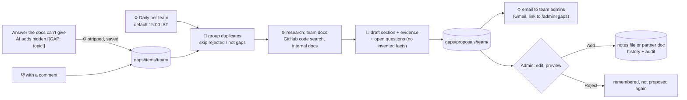

- Lists: one per team (its admins), plus "shared" (internal users asking across all teams) and
  "partner" (partner docs); both of those go to super admins. Each list has its own schedule.
- Internal drafts only go into the team's notes files (`internal/<team>/notes/`), because repo and
  Chat docs are rewritten by their sources. Partner drafts go into partner docs and show the
  internal-terms warning.
- What the AI couldn't find is listed as "Needs your answer"; the admin types it in before Add.
- Emails come from the account connected with `python scripts/connect_gmail.py` (send-only).

### 12. Insights (admin > Insights) and the answer cache

- **Records:** each question, answer (shortened), feedback and spam reply is saved in
  `analytics/events/` (secrets scrubbed, users as a hash, never emails): audience, team, turn,
  latency, tokens, cached, gap, off-topic.
- **Weekly report** (default Monday 10:00 IST, super admin can change it): numbers computed by code,
  notes by the AI per batch, then one report (topics, where users struggle, FAQ candidates,
  suggestions). Saved, emailed to super admins, then the raw records are deleted. "Download JSON
  so far" gives the raw records at any time.
- **Answer cache** (`bot/answer_cache.py`): the first question of a conversation, normalised
  (case, spaces, trailing ?), with the same audience, team and knowledge version, gets the saved
  answer instantly. Never cached: follow-ups, gaps, off-topic, errors, stopped answers. A 👎 or
  any knowledge change removes it. Live test: 6.8 s with the AI, 0.0 s from the cache.

### 13. Question counts (top of the admin page)

Running counters per day and per list (team, shared, partner), kept for good (not cleared by the
weekly insights): asked, answered from the docs, gaps, 👍 / 👎, off-topic / spam, from cache, AI
errors. Today / 7 days / 30 days / all time. Team admins see their team; super admins every list.
Stored in `stats/daily/<date>.json` (`bot/stats.py`).

### Files

| File | What it does | AI? |
|---|---|---|
| `app/main.py` | FastAPI server: `/`, `/admin`, `/api/config`, `/api/login`, `/api/chat`, `/api/summarize`, `/api/feedback`, `/api/admin/*`, `/healthz`; access and admin codes, rate limit, logging, startup checks | Calls the engine |
| `app/static/index.html` | Chat page: Google sign-in, saved chats, streaming markdown, copy buttons, 👎 feedback, memory card | No |
| `app/static/admin.html` | Admin page: Google sign-in, files (partner and internal), section update / replace / new, red-green preview, reason, apply, history, restore, audit trail, knowledge sources with schedules | No |
| `bot/users.py` | Who is internal; each user's saved chats and memory | No |
| `bot/teams.py` | Teams, super admins and team admins | No |
| `bot/analytics.py` | Interaction records, weekly AI report, flush | 🤖 Yes (report) |
| `bot/stats.py` | Daily question counters for the admin page | No |
| `bot/answer_cache.py` | Saved answers for repeated first questions | No |
| `bot/gaps.py` | Gap marker, gap records, daily grouping, research and drafts, proposals | 🤖 Yes |
| `bot/mailer.py`, `scripts/connect_gmail.py` | Sends gap emails from the connected Gmail account | No |
| `bot/blobs.py` | Storage for app data (users, sources): local folder or GCS bucket | No |
| `bot/retrieval.py` | Internal docs catalog and keyword search for internal users | No |
| `bot/sources.py` | Source list and schedules | No |
| `bot/jobs.py` | Job queue (one at a time), scheduler, saving generated docs with audit | No |
| `bot/github_docs.py` | Repo → doc: download, file choice, secret blanking, full build and weekly delta | 🤖 Yes |
| `bot/gchat_docs.py` | Chat space → doc: read new messages, clean, extract Q&A, append | 🤖 Yes |
| `bot/admin_auth.py` | Who is an admin: Google ID-token check, signed session cookie, IAP header, dev codes | No |
| `bot/config.py` | Reads every setting from `.env` | No |
| `bot/prompt.py` | Instructions, docs block (reloaded on version change), partner-context block, summary instructions | No (builds the prompt) |
| `bot/engine.py` | Talks to the chosen provider: `stream_answer()` for answers, `complete()` for summaries | 🤖 Yes |
| `bot/guardrails.py` | Internal-name rules, doc sanitising, streaming answer filter, secret scrubbing, probe flags | No |
| `bot/abuse.py` | Rate limits, gibberish/repeat checks, strikes, 2-hour blocks, concurrency limit | No |
| `bot/knowledge_store.py` | Reads and writes the knowledge (local folder or GCS), history, version, audit trail | No |
| `bot/sections.py` | Section matching and merge, diff | No |
| `cli.py` | Terminal chat for testing answers | 🤖 Yes, via the engine |
| `knowledge/*.md` | The docs the bot answers from (git-ignored, not public) | Read by the AI |
| `internal_terms.txt` | Names the bot must never reveal (git-ignored); `internal_terms.example.txt` shows the syntax | No |
| `chat_export/export_gchat.py` | Exports a Google Chat space | No |
| `chat_export/clean_chat.py` | Cleans and redacts the export into transcript windows | No |
| `chat_export/extraction_prompt.md` | Instructions for the AI step that pulls Q&A out of the windows | Used with 🤖 |
| `chat_export/build_faq.py` | Picks publishable FAQ candidates | No |
| `docs/deploy-gcp.md` | Google Cloud deployment (Cloud Run, bucket, Secret Manager, IAP) | No |
| `logs/` | `chats.jsonl`, `feedback.jsonl` (git-ignored) | No |

### What is stored where

| Data | Where | Kept for |
|---|---|---|
| User's session summary | `users/<uid>/memory.json` in the data store (`data/` or the bucket) | Used for 30 days after its last update, until Forget |
| User's chats | `users/<uid>/conversations/` and `index.json` in the data store | Last 200 per user (`MAX_CONVERSATIONS`), until deleted |
| Source list, schedules, run history | `sources/registry.json` in the data store | Live (last 20 runs per source) |
| Teams and team admins | `teams/registry.json` in the data store | Live |
| Interaction records (for insights) | `analytics/events/` in the data store | Until the next weekly report |
| Insights reports | `analytics/reports/` | Kept |
| Saved answers (cache) | `cache/answers/` | 7 days, or until the knowledge changes |
| Documentation gaps and drafts | `gaps/items/`, `gaps/proposals/`, `gaps/state.json` in the data store | Fixed/dismissed gaps 60 days |
| Internal docs (repos, Chat spaces) | `internal/` next to the knowledge (folder or bucket) | Live, with history |
| Questions and answers | `logs/chats.jsonl` on the server, secrets scrubbed | Until deleted |
| Feedback | `logs/feedback.jsonl` | Until deleted |
| Admin audit trail (sign-ins, changes with diffs and reasons) | `_audit/` next to the knowledge (local folder or GCS bucket), one file per month locally | Kept (append-only) |
| Last modification of each file (who, when, reason, exact diff) | `_last_modified.json` next to the knowledge | Only the latest change per file; overwritten on every update |
| Old versions of each file | `_history/` next to the knowledge | All versions (no limit yet) |
| Docs | `knowledge/` or the GCS bucket | Live |
| API keys, codes | `.env` locally; Secret Manager on Google Cloud | n/a |

## Run locally

**Step-by-step guide for teammates: [docs/LOCAL_SETUP.md](docs/LOCAL_SETUP.md)** (private files, AI key, `.env`, admin sign-in, troubleshooting).

Short version (Python 3.10+):

```bash
git checkout feature/partner-assistant
unzip private-files.zip                     # docs + internal terms, shared privately (not in the repo)
python3 -m venv .venv && source .venv/bin/activate
pip install -r requirements.txt
cp .env.example .env                        # default: your own Claude via Claude Code (no key)
python scripts/check_setup.py               # checks everything and says how to fix it
uvicorn app.main:app --port 8000            # open http://localhost:8000
```

To share the private files with a teammate: `scripts/pack-private.sh` creates `private-files.zip`.

## Configuration (.env)

| Variable | Default | Purpose |
|---|---|---|
| `PROVIDER` | `anthropic` | `anthropic` (Claude API), `openai_compatible` (Gemini, Groq, OpenRouter, Ollama, ...), or `claude_code` (local Claude Code CLI on your own subscription; personal local testing only, refuses access codes and non-localhost requests) |
| `ANTHROPIC_API_KEY` | — | Required when `PROVIDER=anthropic` |
| `LLM_BASE_URL`, `LLM_API_KEY`, `LLM_MODEL` | — | Endpoint, key and model when `PROVIDER=openai_compatible`; see `.env.example` |
| `CLAUDE_MODEL` | `claude-opus-5-5` | Model used for answers |
| `CLAUDE_EFFORT` | `medium` | `low` / `medium` / `high`: depth vs. speed and cost |
| `ENABLE_FALLBACKS` | `true` | If Claude declines a request, retry on a fallback model (Claude API only) |
| `BOT_NAME` | Thyrocare Integration Assistant | Shown in UI and used in the prompt |
| `SUPPORT_CONTACT` | the Thyrocare integration team | Where the bot sends partners when it can't answer |
| `ACCESS_CODES` | empty (no login) | `partner:code` pairs, comma separated. **Set this before sharing the URL.** |
| `RATE_LIMIT_PER_MINUTE`, `RATE_LIMIT_PER_HOUR` | `8`, `60` | Questions per user (browser + IP) |
| `STRIKES_TO_BLOCK`, `STRIKE_WINDOW_MINUTES`, `BLOCK_HOURS` | `5`, `30`, `2` | Spam strikes within the window that block a user, and for how long |
| `WARN_AFTER_STRIKES` | `3` | From this strike on, answers carry a warning |
| `BLOCK_BY_IP` | `true` | Block the IP as well as the browser (people behind one office IP share it) |
| `MAX_CONCURRENT_ANSWERS` | `20` | Answers generated at the same time across all users |
| `TRUSTED_PROXY_HOPS` | `0` | Proxies that add `X-Forwarded-For`: `0` local, `1` Cloud Run, `2` Cloud Run behind a load balancer |
| `ADMIN_EMAILS` | empty (admin off) | Google accounts that are admins, comma separated |
| `GOOGLE_CLIENT_ID` | — | OAuth Web client ID for "Sign in with Google" on `/admin` |
| `ADMIN_SESSION_SECRET` | random per start | Signs admin session cookies; set a fixed long value in production |
| `TRUST_IAP` | `false` | `true` only when the app is reachable solely through Google IAP |
| `ADMIN_CODES` | empty | Local-development fallback admin codes (`name:code`); leave empty in production |
| `KNOWLEDGE_BACKEND` | `local` | `local` (`knowledge/` folder) or `gcs` (Cloud Storage bucket, with `KNOWLEDGE_BUCKET`, `KNOWLEDGE_PREFIX`) |
| `KNOWLEDGE_REFRESH_SECONDS` | `60` | How often each instance checks for updated docs |
| `INTERNAL_TERMS_FILE` | `internal_terms.txt` | Internal names to hide; required when `ACCESS_CODES` is set |
| `SUMMARY_IDLE_MINUTES`, `SUMMARY_EVERY_MESSAGES`, `SUMMARY_TTL_DAYS` | `10`, `12`, `30` | When a user's memory is summarised, and when it expires |
| `USER_LOGIN` | `google` if `GOOGLE_CLIENT_ID` is set, else `none` | `google`: everyone signs in, chats saved per user. `none`: local testing |
| `INTERNAL_DOMAINS` | `pharmeasy.in,thyrocare.in` | Workspace domains whose users are internal |
| `LOCAL_USER_INTERNAL` | `false` | With `USER_LOGIN=none`, treat the local user (localhost only) as internal |
| `DATA_BACKEND`, `DATA_DIR`, `DATA_BUCKET`, `DATA_PREFIX` | follow `KNOWLEDGE_*`, `data/` | Where users' chats, memory and the source list are saved |
| `GITHUB_TOKEN`, `GITHUB_ORGS` | empty, `pharmeasy` | Read-only token for repo sources; allowed orgs |
| `REPO_MAX_CHARS`, `REPO_BATCH_CHARS`, `DELTA_MAX_CHARS` | `900000`, `150000`, `200000` | Code read per repo, per AI call, and the biggest diff handled as a delta |
| `GCHAT_TOKEN_FILE` | `chat_export/token.json` | Google sign-in used to read Chat spaces |
| `INTERNAL_CONTEXT_CHARS` | `60000` | Internal doc sections added to an internal user's question |
| `GAP_DEFAULT_TIME`, `GAP_MAX_DRAFTS` | `15:00`, `10` | Default daily gap run time, drafts per list per run |
| `GMAIL_TOKEN_FILE`, `PUBLIC_URL` | `chat_export/gmail_token.json`, `http://localhost:8000` | Gmail sender token; app address for email links |
| `DEFAULT_TEAMS` | empty | Teams created the first time (`slug:Name,...`); then managed on the admin page |
| `SCHEDULER_ENABLED`, `SCHEDULE_TIMEZONE`, `CRON_SECRET` | `true`, `Asia/Kolkata`, empty | Source refresh scheduler; secret for `POST /api/cron/tick` |

## Deploy

**Before deploying, read the checklist: [docs/DEPLOY_CHECKLIST.md](docs/DEPLOY_CHECKLIST.md)** (what is needed and why).

**Google Cloud (Cloud Run): step-by-step guide in [docs/deploy-gcp.md](docs/deploy-gcp.md).** Docs live in a private
Cloud Storage bucket, secrets (API key, partner codes, internal terms) in Secret Manager, admins sign in with Google.
In the cloud the AI must be the Claude API (or Gemini); `PROVIDER=claude_code` is for personal machines only.

**Docker anywhere else:** private files are not baked into the image, so mount them:

```bash
docker build -t integration-bot .
docker run -p 8000:8000 --env-file .env \
  -v "$PWD/knowledge:/srv/knowledge" -v "$PWD/internal_terms.txt:/srv/internal_terms.txt:ro" integration-bot
```

Notes:
- Chat logs are written to `logs/` inside the container and are lost on redeploy unless you mount a volume.
- Rate limits and blocks are in memory, so run a single instance (fine for a pilot), or move them to Redis.

## Reviewing answers

- `logs/chats.jsonl`: every question, answer, partner, latency and token usage.
- `logs/feedback.jsonl`: 👍/👎 from partners, with optional comments.

Review the 👎 answers regularly. Fix the gap in the docs through `/admin` (or add it to `03-known-gaps.md`); the bot picks it up within a minute, no redeploy needed.

---

# v0 Platform Plan

This plan turns the single-team pilot into a platform that any team in the org can use. It is all part of v0, delivered in phases (see [Delivery phases](#11-delivery-phases)), so that the DSA team keeps a working bot at every step.

## Requirements

Every requirement agreed so far, where it is designed, the phase that delivers it, and how we know it is done. R1–R11 come from the pilot and the platform scope; R12–R17 come from the continuous-learning design (learning from past and new partner conversations).

| ID | Requirement | Designed in | Phase | Done when |
|---|---|---|---|---|
| R1 | **Multi-team.** Each team gets its own bot at `/<team>` with its own docs, branding, partners, limits and AI settings, fully isolated from other teams | [3](#3-url-structure-and-routing), [16](#16-implementation-map) | 0.2 | `/dsa` and `/lab` run side by side; cross-team access tests pass |
| R2 | **Self-service onboarding.** A team supplies docs and a channel link; the platform builds, tests and publishes its bot without code changes | [5](#5-team-onboarding-docs-and-channel) | 0.4 | The Lab bot is built entirely through the admin panel |
| R3 | **Admin panel** with SSO, roles and the screens to run a team's bot | [4](#4-admin-panel) | 0.3 | A team admin manages partners, limits and activity without us |
| R4 | **Track every activity.** Logins, questions, answers, feedback, limit hits and admin changes are recorded and traceable to a partner and user | [6.1](#61-what-is-recorded) | 0.1 | Every request appears in `events` |
| R5 | **Misuse detection.** Automatic rules flag floods, scripted use, off-topic use, prompt injection, shared codes and login abuse | [6.2](#62-finding-misuse) | 0.6 | A simulated flood and injection attempt are flagged and throttled |
| R6 | **Rate limiting and budgets.** Layered limits per user, partner, team, IP and globally, enforced across all instances | [6.3](#63-rate-limiting) | 0.1 | Limits hold with 2+ app instances |
| R7 | **Choice of AI provider with the team's own key**, chosen from a dropdown and stored encrypted, never in `.env` | [7](#7-choice-of-ai-provider-and-the-teams-own-key) | 0.5 | A team switches provider and key; the test question set passes |
| R8 | **Automated email monitoring.** Partner emails matching agreed queries are classified and get draft replies for human approval | [8](#8-automated-email-monitoring) | 0.7 | Every matching email gets a draft or routing decision within 5 minutes |
| R9 | **Horizontal scale.** Stateless app, shared state in Postgres and Redis, workers for slow jobs | [9](#9-architecture-for-scale), [18](#18-system-design-and-scalability) | 0.1 | Runs on N instances behind a load balancer |
| R10 | **Accurate, safe answers.** Answer only from the team's knowledge, cite the source, say when something isn't covered, never ask for or repeat tokens or patient data, decline off-topic questions | [5.2](#52-onboarding-flow), [12](#12-knowledge-layers-and-answer-flow) | Pilot (done) | Accuracy test set passes on every knowledge version |
| R11 | **Partner feedback.** 👍/👎 with comments on every answer, reviewed by the team | [6.1](#61-what-is-recorded), [14](#14-gap-detection-and-feedback-loop) | Pilot (done); moves to the database in 0.1 | Ratings appear in the admin panel and gap report |
| R12 | **History backfill.** 3–4 years of partner emails and Google Chat threads are distilled into a reviewed FAQ | [13.2](#132-one-time-history-backfill) | 0.8 | Backfilled FAQ approved and published; held-out questions form the accuracy test set |
| R13 | **Weekly refresh.** New Q&A from the Google Chat channel and email are collected every week and proposed as FAQ entries | [13.3](#133-weekly-refresh-pipeline) | 0.8 | The Saturday run produces a review queue with no manual steps |
| R14 | **Human review gate.** Nothing learned from Chat or email reaches partners until a team member approves it | [13.4](#134-review-gate-and-publishing) | 0.8 | Unapproved entries are never in a published knowledge version |
| R15 | **Docs and FAQ combined, docs win.** Answers draw on both layers with clear precedence and cite which one they used | [12](#12-knowledge-layers-and-answer-flow) | 0.8 | Conflict test cases follow the docs and are flagged |
| R16 | **Gap detection.** Unanswered questions, 👎 answers and doc contradictions are grouped into a weekly gap report, with instant alerts for spikes | [14](#14-gap-detection-and-feedback-loop) | 0.8 | Weekly report delivered; a test spike triggers an alert |
| R17 | **Integration autopilot.** Payload checker, sandbox test runner, code generator, per-partner checklist and go-live certification | [15](#15-integration-autopilot-after-v0) | After v0 | Starts once R12–R16 are stable and accuracy meets target |

## 1. Goals and non-goals

**Goals**

1. **Multi-team.** Each team (DSA, Lab, others later) gets its own bot at its own URL, `https://<base-url>/dsa`, `https://<base-url>/lab`, with its own documentation, branding, partners, limits and AI settings.
2. **Self-service onboarding.** A team gives us its documentation and the link to its partner channel. The platform builds the team's bot from that, without code changes or a redeploy.
3. **Track every activity.** Every login, question, answer, feedback, limit hit and admin change is recorded, so misuse can be found quickly and traced to a partner and user.
4. **Keep usage minimal and fair.** Layered rate limits and token budgets stop any partner from flooding the system or running up cost.
5. **Choice of AI provider with the team's own key.** A team admin picks a provider from a dropdown (Claude, Gemini, OpenAI), pastes their API key, and the bot uses that provider and key.
6. **Automated email monitoring.** Replace the manual process where a senior watches the shared mailbox. The platform reads partner emails that match agreed search queries, drafts answers with the bot, and flags anything that needs a person.
7. **Scale horizontally.** Nothing in the app is tied to one machine, so we can add instances as teams and partners grow.

**Non-goals for v0**

- **No model training or fine-tuning.** "Building the model from the docs" means building a knowledge pack and system prompt for the team. The underlying AI model stays the provider's general model. This keeps onboarding to minutes and lets a team update docs at any time.
- No public sign-up. Teams are created by a platform admin.
- No automatic sending of email replies without human approval (see [section 8](#8-automated-email-monitoring)).
- No mobile app. The chat page and admin panel are responsive web pages.

## 2. Terms

| Term | Meaning |
|---|---|
| **Platform admin** | Our team. Creates teams, sees everything, handles abuse. |
| **Team** (tenant) | An internal team that owns a bot, e.g. DSA, Lab. Identified by a short URL slug: `dsa`, `lab`. |
| **Team admin** | A person from that team who manages its bot: docs, partners, AI provider and key, limits, email monitoring. |
| **Partner** | An external company the team works with (e.g. a DSA partner integrating the API). |
| **Partner user** | An individual at a partner who chats with the bot. |
| **Knowledge pack** | The processed, versioned documentation a team's bot answers from. |
| **Provider** | The AI vendor: Anthropic (Claude), Google (Gemini), OpenAI. |

## 3. URL structure and routing

| URL | Who | What |
|---|---|---|
| `/<team>` | Partner users | Chat page for that team, e.g. `/dsa`, `/lab`. Shows the team's bot name and branding. |
| `/<team>/api/chat`, `/<team>/api/feedback`, `/<team>/api/login` | Chat page | Same endpoints as today, scoped to the team. |
| `/admin` | Platform admins | All teams, global usage, abuse queue, audit log. |
| `/admin/<team>` | Team admins (own team only) and platform admins | Team settings, docs, partners, AI provider, limits, email monitoring, activity. |
| `/healthz` | Load balancer | Liveness. `/readyz` checks the database and Redis. |

Rules:

- Slugs are lowercase letters, digits and hyphens, 2–32 characters, unique, and cannot collide with reserved words (`admin`, `api`, `static`, `healthz`, `readyz`, `login`).
- Every request resolves the team from the URL first. An unknown or disabled team returns 404, so slugs are not discoverable through error messages.
- A request for one team can never read another team's data. Every database query filters by `team_id`, enforced in one data-access layer rather than in each handler. This is tested.
- Optional later: a subdomain per team (`dsa.<base-url>`) mapped to the same slug. The path form is the default because it needs one TLS certificate and one DNS record.

## 4. Admin panel

### 4.1 Access

- Admins sign in with the org's Google Workspace SSO (OIDC). No passwords stored by us.
- Roles: `platform_admin`, `team_admin` (scoped to one or more teams), `team_viewer` (read-only: activity and reports).
- Sessions are short-lived (8 hours) with an HTTP-only, secure, same-site cookie. Every admin action is written to the audit log.

### 4.2 Screens

| Screen | Contents |
|---|---|
| **Teams** (platform admin) | List of teams with status, partners, questions today, tokens and estimated cost this month, open abuse flags. Create, disable, delete team. |
| **Team overview** | Questions per day, active partners, 👍/👎 ratio, top questions, unanswered ("not in docs") rate, cost vs budget. |
| **Knowledge** | Uploaded sources, current published version, draft versions, diff between versions, test chat against a draft, publish and roll back. See [section 5](#5-team-onboarding-docs-and-channel). |
| **Partners** | Add partner, issue and revoke access codes, per-partner limit overrides, block/unblock, last activity. |
| **AI provider** | Provider dropdown, model dropdown, API key field, "Test key" button, effort/temperature, monthly token budget. See [section 7](#7-choice-of-ai-provider-and-the-teams-own-key). |
| **Limits** | Rate limits and budgets for the team (within platform maximums). |
| **Email monitoring** | Mailbox connection, search queries, draft queue, digest settings. See [section 8](#8-automated-email-monitoring). |
| **Activity** | Searchable event log: filter by partner, user, event type, date, flags. Export CSV. |
| **Flags** | Abuse and quality flags for review, with actions (dismiss, warn, throttle, block). |
| **FAQ review** | Proposed FAQ entries from Chat, email and the history backfill, with source threads, frequency and doc-check result; approve, edit, reject. See [section 13](#13-continuous-learning-from-chat-and-email). |
| **Gaps** | Weekly gap report: topics the docs don't cover, contradictions, 👎 clusters, with draft doc text and status. See [section 14](#14-gap-detection-and-feedback-loop). |
| **Settings** | Bot name, support contact, logo, welcome message, suggested questions, allowed languages. |

## 5. Team onboarding: docs and channel

### 5.1 What the team gives us

1. **Documentation**: PDFs, Word files, Markdown, or links to public doc pages (the DSA bot started from two PDFs: the B2B API Suite and the B2B Lead API).
2. **Channel link**: where their partners reach them today. This can be a shared mailbox (e.g. a Google Group), a Slack or Google Chat channel, or a support form. It is used for the support contact shown in the bot and, for mailboxes, as the source for [email monitoring](#8-automated-email-monitoring).
3. **Team admins**: the people who will manage the bot.
4. **Partner list**: partner names and contact emails, to issue access codes.

### 5.2 Onboarding flow

```
Platform admin                Team admin                         Platform (background worker)
──────────────                ──────────                         ────────────────────────────
Create team (slug, name,
admins)  ──────────────────►  Signs in to /admin/<team>
                              Uploads docs, adds channel link ─► 1. Store originals in object storage
                                                                 2. Convert each file to Markdown
                                                                 3. Clean up: headings, tables, code samples
                                                                 4. Find gaps/contradictions → draft
                                                                    "known gaps" document
                                                                 5. Build draft knowledge pack (version N)
                              Reviews draft, edits Markdown,  ◄─ 6. Run test questions, show answers
                              runs test chat against draft
                              Clicks Publish ─────────────────►  7. Version N becomes live for /<team>
                              Adds partners, sends codes
```

Details:

- **Conversion.** PDFs and Word files are converted to Markdown with a document-to-text step followed by a model pass that fixes tables, code blocks and headings. The originals are kept, so a pack can be rebuilt.
- **Known gaps.** The model reads the converted docs and lists unclear or contradictory points (as `knowledge/03-known-gaps.md` does for DSA today, e.g. the gender format differing between the Lead API and the Create Order API). The team admin confirms or edits each point. The bot tells partners these points need confirmation instead of guessing.
- **Test questions.** The platform generates about 20 typical partner questions from the docs, runs them against the draft, and shows the answers for the team admin to check before publishing. Teams can add their own test questions; these run again on every new version to catch regressions.
- **Versioning.** Every publish creates an immutable version. Chat logs record which version answered each question. Roll back is one click.
- **Prompt template.** The system prompt rules in `bot/prompt.py` (answer only from docs, cite the source, never ask for tokens or patient data, decline off-topic) become the platform default. A team can add team-specific instructions, but cannot remove the safety rules.

### 5.3 How the docs reach the model

- **Small packs (the default).** If a team's whole pack fits comfortably in the model's context (the DSA pack is about 1,500 lines), the whole pack is sent in the system prompt on every request with prompt caching, exactly as the pilot does. This gives the most accurate answers and is cheap after the first request because the docs are cached.
- **Large packs.** Above a size threshold (set per provider, roughly a quarter of the model's context window), the platform switches that team to retrieval: the pack is split into sections, embedded, stored in Postgres with `pgvector`, and the most relevant sections are sent with each question. The switch is automatic and shown in the admin panel.
- **FAQ layer.** Alongside the docs, each knowledge version can include an approved FAQ learned from partner conversations. How the two layers combine, and which one wins, is in [section 12](#12-knowledge-layers-and-answer-flow).
- Cache keys are per team and per pack version, so one team's docs never appear in another team's prompt.

## 6. Activity tracking, misuse detection and rate limiting

### 6.1 What is recorded

Every event is written to an append-only `events` table (and the chat content to `messages`). Nothing is updated or deleted by the app; retention is handled by a scheduled job.

| Event | Recorded fields (in addition to the common ones below) |
|---|---|
| `login.success` / `login.failed` | access code id (never the code itself), failure reason |
| `chat.question` | message id, conversation id, question text, length, language |
| `chat.answer` | message id, answer text, provider, model, knowledge version, latency, input/output/cached tokens, estimated cost, stop reason (normal, refusal, cut short, error), whether it said "not covered in the docs" |
| `chat.feedback` | message id, 👍/👎, comment |
| `limit.hit` | which limit, current count, limit value |
| `guard.triggered` | which guard (prompt injection, secret or patient data detected, off-topic), action taken |
| `admin.*` | admin user, action (key changed, partner blocked, doc published, limit changed, ...), before/after values (secrets masked) |
| `email.*` | message id, matched query, classification, draft created, approved/rejected, sent by |

Common fields on every event: `id`, `ts` (UTC), `team_id`, `partner_id`, `user_id` (partner user or admin), `conversation_id`, `request_id`, IP address, user agent, country (from IP).

**Identifying partner users.** Today an access code identifies only the partner. In v0 each partner user signs in with their work email and a one-time code sent to it (the partner's allowed email domains are set by the team admin). This lets us trace activity to a person, not only a company. Access codes remain as a fallback for partners who cannot receive email codes.

**Privacy.** Partners are told in the chat page that conversations are logged. A detector masks tokens, passwords and patient-like data (names with dates of birth, phone numbers, Aadhaar-like numbers) before storage, and the prompt already tells the bot not to ask for them. Chat content is kept 180 days by default (configurable per team), then deleted; aggregated counts are kept.

### 6.2 Finding misuse

Automatic rules raise a **flag** for review on the Flags screen and in a daily email to platform admins:

| Rule | Example threshold (configurable) |
|---|---|
| Volume spike | A partner's questions in an hour are more than 3× their 7-day hourly average and over 20 |
| Repeated questions | Same or near-identical question more than 10 times in an hour (scripted use) |
| Off-topic use | More than 30% of a partner's answers in a day are refusals or off-topic declines (using the bot as a free general chatbot) |
| Prompt injection | Messages trying to override instructions, extract the system prompt, or reveal other teams' or partners' data |
| Token spend | A partner uses more than 25% of the team's daily token budget |
| Login abuse | More than 10 failed logins from an IP or for a code in 15 minutes |
| Shared codes | One access code used from more than 3 countries or 10 IPs in a day |
| After-hours bursts | Large volume at unusual hours for that partner |

Actions from a flag: dismiss, warn the partner (email), lower that partner's limits, block temporarily, block permanently. Severe rules (prompt injection with data extraction attempts, login abuse) throttle automatically and then wait for review.

### 6.3 Rate limiting

Limits are enforced in Redis so they hold across all app instances (the pilot's in-memory limiter works only on one instance). Requests over a limit get HTTP 429 with a `Retry-After` header and a clear message in the chat.

| Layer | Default | Purpose |
|---|---|---|
| Per partner user | 10 questions/minute, 100/day | Stops one person flooding |
| Per partner | 60 questions/hour, 500/day | Keeps any partner's usage minimal (60/hour is the pilot's default) |
| Per partner, concurrent | 3 answers streaming at once | Stops parallel scripts |
| Per team | Daily and monthly token budget, set by the team admin | Controls cost; at 80% team admins get an email, at 100% the bot pauses for that team with a polite message |
| Per IP (before login) | 20 requests/minute to login endpoints | Stops brute force on codes |
| Global | Platform-wide ceiling on concurrent provider calls | Protects us and the provider accounts |
| Message size | 8,000 characters per question, last 20 messages of history | Already in the pilot (`MAX_MESSAGE_CHARS`, `MAX_HISTORY_MESSAGES`) |

Algorithm: sliding-window counters in Redis (sorted sets or a token bucket via a Lua script, so check-and-increment is atomic). Team admins can change limits within platform maximums; platform admins can override per partner.

## 7. Choice of AI provider and the team's own key

### 7.1 What the team admin sees

On **AI provider** in `/admin/<team>`:

1. **Provider** dropdown: `Claude (Anthropic)`, `Gemini (Google)`, `OpenAI`.
2. **Model** dropdown, filled for the chosen provider from a model list the platform admin maintains (so we can add new models without a release). For Claude the default is `claude-opus-5-5`, as in the pilot.
3. **API key** field (password field). After saving, only the last 4 characters are shown.
4. **Test key** button: makes a tiny request to the provider and shows success, or the exact error (invalid key, no billing, model not available on this key).
5. Effort or temperature, maximum answer length, monthly token budget.

If a team has not added its own key, it uses the platform's default key, with stricter platform budgets.

### 7.2 Where keys are stored (a change from "put it in .env")

The original idea was to put each team's key in our `.env`. That does not work for a multi-team platform:

- One `.env` is shared by the whole deployment, so every team's key would sit in one file that everyone with server access can read.
- Changing `.env` needs a redeploy or restart, so a team could not add or rotate a key themselves.
- With several app instances, every instance would need the same file kept in sync.

**Plan instead:** keys are stored encrypted in the database.

- Each key is encrypted with envelope encryption: a per-key data key encrypts the API key (AES-256-GCM), and the data key is encrypted by a master key held in AWS KMS (or Secrets Manager). The database never holds a usable key.
- `.env` holds only platform settings: database and Redis URLs, the KMS key id, and the platform's default provider keys.
- The app decrypts a team's key only in memory when calling the provider, and caches it for a few minutes.
- Keys never appear in logs, events, error messages or the admin panel after saving. Changes to a key are audited (who, when, last 4 characters), not the key itself.
- Rotation: the team admin pastes a new key and tests it; the old one is deleted.

### 7.3 Provider abstraction in the code

`bot/engine.py` calls the Anthropic SDK directly today. It becomes a small provider interface with one implementation per provider:

```python
class Provider(Protocol):
    async def stream(self, system: list[Block], messages: list[Message], settings: ModelSettings) -> AsyncIterator[Chunk]: ...
    async def test_key(self) -> KeyCheckResult: ...
```

- `AnthropicProvider`: today's code (prompt caching on the docs, effort setting, refusal fallback).
- `GeminiProvider` and `OpenAIProvider`: use each vendor's official SDK, with their own caching where available.
- Each returns the same normalized result: text chunks, token usage, stop reason (`normal`, `refusal`, `max_tokens`, `error`). Logging, limits and cost tracking work the same for all providers.
- Features one provider lacks are switched off cleanly for it (for example, the refusal fallback is Claude API only, as noted in `.env.example`).
- The same test question set from [5.2](#52-onboarding-flow) runs when a team switches provider, so the team can compare answer quality before it goes live.

## 8. Automated email monitoring

### 8.1 Today vs v0

Today a senior person reads the shared partner mailbox and works out which emails are integration questions. In v0 the platform reads the mailbox, finds the relevant emails using agreed search queries, drafts an answer from the team's knowledge pack, and puts the draft in a review queue. A person approves, edits, or rejects each draft. Nothing is sent without approval in v0. After a few weeks of data (approval rate per category), we can allow automatic sending for low-risk categories that a team admin turns on.

### 8.2 Flow

```
Shared mailbox ──► Poller (every 2 min) ──► Match search queries ──► Classify ──► Draft answer ──► Review queue ──► Person approves ──► Reply sent
 (Gmail API /       new mail since           (section 8.3)             (8.4)        (team's bot,      (admin panel,      / edits           from the
  Microsoft Graph)  last check                                                       same docs)        Slack/email ping)  / rejects        team mailbox
```

- **Connection.** The team admin connects the mailbox with OAuth (Gmail API for Google Workspace, Microsoft Graph for Outlook), read and send-as scopes only. Tokens are stored encrypted like API keys. Push notifications (Gmail watch / Graph subscriptions) can replace polling later.
- **Threads.** Emails are grouped by thread. A thread already answered by a person is skipped. A follow-up in a thread we drafted for gets a new draft that includes the history.
- **Partner matching.** The sender's domain is matched to a partner, so drafts, activity and limits are tracked per partner, just like chat.
- **Attachments.** Request payloads and error logs attached as text or JSON are read; screenshots are passed to providers that accept images; other files are listed in the draft for the reviewer.
- **Safety.** Emails are untrusted input. Instructions inside an email never change the bot's rules, the bot cannot send anything itself, and drafts go through the same secret and patient-data masking as chat.
- **Notifications.** New drafts trigger a ping in the team's channel (Slack or Google Chat) or an email. A daily digest lists: new integration emails, drafts waiting, emails older than 24 hours with no reply, and the top recurring questions.
- **SLA tracking.** Time from email received to reply sent is recorded per partner and category, and shown in the admin panel.
- **Docs feedback loop.** Questions the bot could not answer from the docs are grouped weekly into "missing from docs" topics for the team admin to add to the knowledge pack (full design in [section 14](#14-gap-detection-and-feedback-loop)). Approved replies also become FAQ candidates ([section 13](#13-continuous-learning-from-chat-and-email)).

### 8.3 Search queries

These are the starting queries for the DSA team, written in Gmail search syntax (equivalent Microsoft Graph `$search` filters are generated automatically). Team admins can add, edit, disable and test queries in the admin panel ("Test" shows the emails a query would have matched in the last 30 days).

| # | Category | Query (Gmail syntax) | Why |
|---|---|---|---|
| 1 | Partner mail, any topic | `from:(*@partner1.com OR *@partner2.com ...) newer_than:1d` | Built automatically from the partner list's email domains. Base filter for everything below. |
| 2 | Auth / credentials | `subject:(token OR "api key" OR credentials OR login OR authentication OR "access key") OR "401" OR "403" OR unauthorized OR "token expired"` | Most common blocker at the start of an integration |
| 3 | Errors and failures | `"error" OR "failed" OR "failure" OR "not working" OR "500" OR "400" OR "bad request" OR "timeout" OR exception` | Live integration problems |
| 4 | Leads | `"lead" (create OR push OR status OR duplicate OR rejected)` | Lead API questions |
| 5 | Orders / booking | `order (create OR cancel OR reschedule OR status OR booking) OR "slot"` | Create Order API questions |
| 6 | Catalog / pricing | `catalog OR "product code" OR "test code" OR package OR profile OR price OR rate` | Product list and price questions |
| 7 | Reports | `report OR "report url" OR pdf OR result` (with a partner sender) | Report retrieval questions |
| 8 | Webhooks / callbacks | `webhook OR callback OR "status update" OR notification OR "not receiving"` | Status callback problems |
| 9 | Environments / go-live | `UAT OR staging OR sandbox OR production OR "go live" OR "go-live" OR whitelist OR "IP whitelisting"` | Onboarding milestones that need a person |
| 10 | Docs and field formats | `"documentation" OR "api doc" OR "postman" OR "payload" OR "request body" OR "field" OR mandatory OR format` | General integration help |
| 11 | Pincode / serviceability | `pincode OR serviceability OR "not serviceable" OR "area"` | Coverage questions |
| 12 | Escalations (no draft, alert only) | `urgent OR escalate OR escalation OR complaint OR "legal" OR "payment" OR invoice OR refund` | Must go straight to a person; the bot does not draft for these |

Queries 2–11 are refined after the first two weeks using the logged matches (which queries catch emails that turn out to be irrelevant, and which integration emails no query caught). The Lab team's queries start from the same categories, with keywords from their own docs suggested automatically during onboarding.

### 8.4 Classification

Each matched email is classified by the model into one of: `integration_question`, `error_report`, `onboarding_or_go_live`, `escalation`, `commercial` (pricing, contracts, payments), `not_relevant`. Only `integration_question` and `error_report` get drafts. `onboarding_or_go_live`, `escalation` and `commercial` are routed to a person with a summary. `not_relevant` is logged and ignored. The classification and the model's confidence are shown in the review queue, and reviewers can correct them, which is logged to improve the queries and prompts.

## 9. Architecture for scale

```
                         ┌────────────────────────────── AWS ─────────────────────────────────┐
Partners ─┐              │                                                                     │
Admins  ──┼─► CDN/WAF ──►│ Load balancer ──► App (FastAPI, N stateless containers, ECS Fargate)│
          │              │                       │        │          │            │            │
          │              │                       ▼        ▼          ▼            ▼            │
          │              │                 Postgres    Redis      S3 bucket    KMS / Secrets   │
          │              │                 (RDS, +     (limits,   (original    Manager         │
          │              │                 pgvector)   sessions,  docs,        (key            │
          │              │                             queue)     exports)     encryption)     │
          │              │                       ▲        ▲                                    │
          │              │                       └── Worker containers (ingestion, email       │
          │              │                           polling, flags, digests, retention)       │
          │              └──────────────┬──────────────────────────────────────────────────────┘
          │                             ▼
          │                  AI providers (Anthropic, Google, OpenAI)    Mailboxes (Gmail / Graph)
```

The full system design, request sequence, capacity estimates and failure handling are in [section 18](#18-system-design-and-scalability).

- **Stateless app.** No local files for logs or limits (the pilot writes `logs/*.jsonl` and keeps limits in memory, which is why it must run as a single instance). All state moves to Postgres and Redis, so we can run as many instances as needed and autoscale on CPU and open connections.
- **Workers.** Slow or scheduled work (doc conversion, embeddings, email polling, flag rules, digests, retention cleanup) runs in separate worker containers from a Redis-backed job queue (e.g. `arq` or Celery), so chat latency is not affected.
- **Streaming.** Answers keep streaming as today. The load balancer idle timeout is raised to at least 120 seconds.
- **Database.** Postgres (RDS) with `team_id` on every table and an index on `(team_id, ts)` for events. The `events` and `messages` tables are partitioned by month so retention is a cheap partition drop.
- **Caching.** Team settings and the published knowledge pack are cached in memory per instance for 60 seconds and invalidated on publish via Redis pub/sub.
- **Provider resilience.** Per-provider timeouts, retries with backoff for rate limit and overload errors, and a circuit breaker so one provider's outage does not tie up all workers. If a team's own key fails (revoked, out of credit), the bot shows a clear message and team admins get an email; it does not silently switch to the platform key.
- **Observability.** Structured JSON logs with `request_id` and `team_id`; metrics (requests, latency, tokens, cost, errors, limit hits per team and provider); alerts on error rate, latency and budget; tracing across app, worker and provider calls.
- **Security.** HTTPS only, WAF rate rules in front of the app, CSRF protection on admin forms, strict CORS (same origin), content security policy on the chat page, dependency scanning in CI, secrets only in KMS/Secrets Manager.
- **Environments.** `dev`, `staging`, `prod`, each with its own database, Redis and keys. Migrations with Alembic run automatically on deploy.

## 10. Data model

| Table | Key columns |
|---|---|
| `teams` | id, slug, name, status, bot_name, support_contact, branding, settings (JSON), created_at |
| `admin_users` | id, email, name, role |
| `team_admins` | team_id, admin_user_id, role |
| `partners` | id, team_id, name, email_domains, status (active/blocked), limit_overrides (JSON) |
| `partner_users` | id, team_id, partner_id, email, status, last_seen_at |
| `access_codes` | id, team_id, partner_id, code_hash, created_by, revoked_at |
| `provider_configs` | team_id, provider, model, settings (JSON), encrypted_key, key_last4, key_updated_by, key_updated_at |
| `knowledge_sources` | id, team_id, filename or url, s3_path, uploaded_by, uploaded_at |
| `knowledge_versions` | id, team_id, version, status (draft/published/archived), markdown (or s3_path), size_tokens, mode (full/retrieval), published_by, published_at |
| `knowledge_chunks` | id, version_id, section, text, embedding (vector) |
| `test_questions` | id, team_id, question, expected_notes |
| `conversations` | id, team_id, partner_id, user_id, channel (chat/email), started_at |
| `messages` | id, conversation_id, team_id, role, content (masked), knowledge_version_id, provider, model, tokens_in, tokens_out, tokens_cached, cost, latency_ms, stop_reason, created_at |
| `feedback` | message_id, team_id, rating, comment, created_at |
| `events` | id, ts, team_id, partner_id, user_id, type, request_id, ip, user_agent, data (JSON) |
| `flags` | id, team_id, partner_id, rule, severity, status, evidence (JSON), resolved_by, resolution |
| `limits` | team_id, scope, key, value |
| `mailboxes` | id, team_id, provider (gmail/graph), address, encrypted_oauth_token, last_synced_at |
| `email_queries` | id, team_id, category, query, enabled, draft_allowed |
| `email_items` | id, team_id, mailbox_id, thread_id, message_id, partner_id, matched_query_id, classification, confidence, status (new/drafted/approved/rejected/sent/ignored), draft, reviewer_id, received_at, replied_at |
| `source_threads` | id, team_id, source (gchat/email/bot/backfill), external_id, thread_ts, content (masked), ingestion_run_id. Unique on (team_id, source, external_id) so re-runs never duplicate |
| `ingestion_runs` | id, team_id, source, started_at, finished_at, watermark (last message time read), counts (JSON), status |
| `faq_entries` | id, team_id, question, answer, api, topic, embedding (vector), times_asked, doc_check (consistent/contradicts/not_in_docs), status (proposed/approved/rejected/suspended), last_verified_at, approved_by |
| `faq_sources` | faq_entry_id, source_thread_id (which threads an entry was learned from) |
| `answer_checks` | message_id, team_id, label (answered/partial/not_covered/needs_confirmation), checked_at |
| `gaps` | id, team_id, topic, example_questions (JSON), partners_affected, signal_counts (JSON), draft_doc_text, status (open/in_progress/fixed/wont_fix/reopened), opened_at, fixed_at |

## 11. Delivery phases

All phases are part of v0. Each ends with something usable, and the DSA bot keeps working throughout.

| Phase | Scope | Done when |
|---|---|---|
| **0.1 Foundations** | Postgres and Redis; move chat logs, feedback and rate limits out of local files and memory; `events` table with tracking of every chat, login and limit event; Redis rate limits (all layers in 6.3) | DSA pilot runs on 2+ instances with the same behaviour, and every request is in `events` |
| **0.2 Multi-team** | `teams` table, `/<team>` routing, DSA moved to `/dsa`, team-scoped data access layer, per-team settings and knowledge pack loaded from the database | `/dsa` works as today; a second test team at `/lab` has separate docs, partners and logs; cross-team access tests pass |
| **0.3 Admin panel** | SSO login, roles, Teams, Partners, Settings, Limits, Activity screens; partner user email sign-in | A team admin can add partners, issue codes, change limits and search activity without us |
| **0.4 Onboarding** | Doc upload, conversion, known-gaps draft, test questions, versions, publish and roll back, retrieval mode for large packs | The Lab team's bot is built from their docs through the admin panel, without code changes |
| **0.5 Providers and keys** | Provider interface, Gemini and OpenAI implementations, AI provider screen, encrypted key storage with KMS, key test, budgets | A team switches provider and key from the dropdown, and the test question set passes |
| **0.6 Misuse detection** | Flag rules (6.2), Flags screen, automatic throttling, daily admin email | A simulated flood and a prompt-injection attempt are both flagged and throttled |
| **0.7 Email monitoring** | Mailbox OAuth, poller, search queries and test tool, classification, drafts, review queue, notifications, digest, SLA tracking | For the DSA mailbox, every matching partner email gets a draft or a routing decision within 5 minutes, and the senior no longer reads the mailbox manually |
| **0.8 Continuous learning** | Knowledge layers (docs + FAQ), history backfill, Google Chat and email collection, weekly pipeline, FAQ review screen, answer check, gap report and alerts (sections 12–14) | The backfilled FAQ is live; the Saturday run fills the review queue unattended; the first weekly gap report is delivered |
| **After v0: Autopilot** | Payload checker, sandbox test runner, code generator, integration checklist, go-live certification ([section 15](#15-integration-autopilot-after-v0)) | Entry: 0.8 stable for 4 weeks and the accuracy target met |

Phase 0.8 can start alongside 0.3–0.7 for the DSA team: the history backfill needs only the database from 0.1 and the knowledge versions from 0.4. Until mailbox OAuth lands in 0.7, email reaches the pipeline through a weekly export the senior runs locally ([13.1](#131-sources-and-how-each-is-collected)).

## 12. Knowledge layers and answer flow

*Requirements: R10, R15.*

### 12.1 What the model receives

Nothing is fetched in sequence. For every question the app builds **one prompt** with five layers and sends it to the provider in a single request. The model reads all layers at once and writes one answer.

| # | Layer | Content | Changes when | Cached |
|---|---|---|---|---|
| 1 | Rules | Platform safety rules + the team's own instructions + precedence rules (below) | Team settings change | Yes |
| 2 | API docs | The team's published docs, full text (or the most relevant sections in retrieval mode, [5.3](#53-how-the-docs-reach-the-model)) | A docs version is published | Yes, breakpoint after this layer |
| 3 | Approved FAQ | Approved entries learned from Chat, email and history, each with its id and "last verified" date ([13](#13-continuous-learning-from-chat-and-email)) | Weekly, when the review queue is published | Yes, breakpoint after this layer |
| 4 | Known gaps | Points confirmed as unclear or inconsistent in the docs | With a docs version | Yes (inside the FAQ breakpoint) |
| 5 | Conversation | The last 20 messages and the new question | Every request | No |

Order matters for cost: layers are ordered from most stable to least stable, so a weekly FAQ publish invalidates only layers 3–4 in the cache, not the docs. On Claude this uses two `cache_control` breakpoints (after layer 2 and after layer 4). Other providers use their own context caching where available ([7.3](#73-provider-abstraction-in-the-code)).

### 12.2 Precedence rules (part of layer 1)

| Situation | What the bot does | Citation shown to the partner |
|---|---|---|
| The docs cover it | Answers from the docs | `Source: <doc> → <section>` |
| Only the FAQ covers it | Answers from the FAQ | `Source: past partner Q&A (FAQ-142), verified 2026-10-04` |
| Docs and FAQ disagree | Follows the docs and says the point needs confirmation | Both sources; the conflict is logged as a gap ([14](#14-gap-detection-and-feedback-loop)) |
| Listed in known gaps | Gives what the docs say and says it needs confirmation | Doc section + "needs confirmation" |
| Nothing covers it | Says it isn't documented and points to the team's support contact | None; logged as `not_covered` |

### 12.3 Request flow

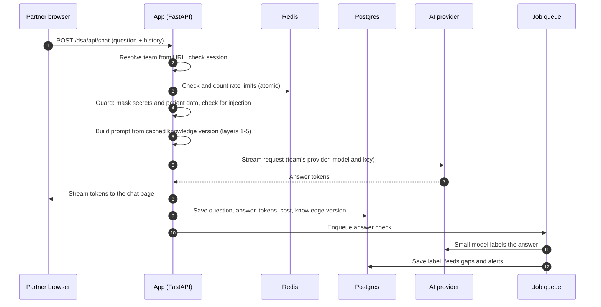

- The knowledge version (layers 1–4) is loaded from the database once and kept in memory per instance; a publish clears it through Redis pub/sub ([9](#9-architecture-for-scale)).
- The **answer check** runs after the answer is streamed, so the partner never waits for it. A small, cheap model labels each answer `answered`, `partial`, `not_covered` or `needs_confirmation`, stored in `answer_checks`.

### 12.4 When the FAQ outgrows the prompt

Above a per-provider size threshold, only the FAQ layer changes mode: FAQ entries are already embedded (`faq_entries.embedding`), so the app sends the ~20 most relevant entries for each question (vector similarity plus keyword match on field names) instead of all of them. The docs stay in full. Nothing else in the flow changes.

### 12.5 Changes to the current code

- `bot/prompt.py`: build layers 1–4 from a knowledge version (separate docs, FAQ and gaps blocks) instead of globbing `knowledge/*.md`; add the precedence and citation rules to the instructions.
- `bot/engine.py`: accept the knowledge version and provider settings; place two cache breakpoints; return normalized usage and stop reason.
- New `bot/answer_check.py` and a worker task that runs it.

## 13. Continuous learning from Chat and email

*Requirements: R12, R13, R14.*

The bot keeps learning from real partner conversations through a reviewed **FAQ**, never by retraining a model. Raw conversations are never put in the prompt: they contain sensitive data, old answers that may be outdated, and noise.

### 13.1 Sources and how each is collected

| Source | Collection | Access needed | Schedule |
|---|---|---|---|
| **Google Chat partner channel** | Worker calls the Google Chat API (`spaces.messages.list` with a `createTime` filter from the last watermark) and groups messages by thread | A Chat app added to the space, or OAuth with `chat.messages.readonly` granted by a Workspace admin | Friday 20:00 |
| **Email, after phase 0.7** | No separate job: approved and sent replies from email monitoring ([8](#8-automated-email-monitoring)) are already question-and-answer pairs and are fed straight into the pipeline | Mailbox OAuth from 0.7 | Continuous; batched weekly |
| **Email, before phase 0.7 (interim)** | A senior runs a small script on their own machine: fetch last week's mail for a fixed Gmail label, strip signatures and quoted text, mask phones, emails and tokens, write one JSONL file to a restricted S3 prefix (`s3://<bucket>/<team>/email-drop/`). Raw email never leaves their machine | Senior's own Gmail access; write-only access to the drop prefix | Friday evening |
| **Bot logs** | Questions, answers, ratings and answer-check labels from `messages`, `feedback`, `answer_checks` | Internal | Friday 20:00 |

Every collector writes `source_threads` rows keyed on (team, source, external id) and records an `ingestion_runs` watermark, so re-running a week never duplicates anything.

### 13.2 One-time history backfill

1. **Export.** Google Takeout for the Chat space (JSON) and the partner mail label (`.mbox`), 3–4 years. Stored in the restricted S3 prefix, deleted after processing.
2. **Parse** into `source_threads` (one row per thread, quoted replies stripped).
3. **Run the weekly pipeline (13.3) over the whole history**, using the provider's batch API (Claude Message Batches costs 50% less and is not time-sensitive). Processed year by year so a review can start before everything finishes.
4. **Age handling.** Old answers are the most likely to be outdated. Every backfilled entry goes through the doc check; entries older than 12 months that are `not_in_docs` are marked for extra scrutiny in review.
5. **Hold-out test set.** About 50 real questions with the team's verified answers are kept out of the FAQ and become the accuracy test set ([5.2](#52-onboarding-flow)) that runs on every new knowledge version.

Cost depends on volume; it is estimated from a 50-thread sample before the full run (open question 10).

### 13.3 Weekly refresh pipeline

Runs as one worker job per team every Saturday 06:00, after all collectors finish.

| Step | What happens | Implementation |
|---|---|---|
| 1. Collect | Read new `source_threads` since the last run | Watermark from `ingestion_runs` |
| 2. Extract | For each thread: the partner's question, the team's final answer, API, topic, date, and whether a team member actually answered. Threads with no resolved answer are dropped | Model call with a strict JSON schema (structured outputs); batch API |
| 3. Redact | Replace names, phone numbers, emails, tokens, passwords, partner ids and patient details with placeholders; flag uncertain cases | Regex detectors + model pass; same masking as chat ([6.1](#61-what-is-recorded)) |
| 4. Match | Embed each candidate and compare with existing FAQ entries: similarity ≥ 0.90 counts as the same question (increase `times_asked`); 0.75–0.90 is shown to the reviewer as "possible duplicate"; below 0.75 is new. A same question with a different answer is flagged as "answer changed?" | `pgvector` cosine similarity; thresholds tuned on the backfill |
| 5. Doc check | Compare each entry with the current docs version: `consistent`, `contradicts`, or `not_in_docs`. Contradictions and `not_in_docs` also feed the gap report | Model call with the docs layer cached |
| 6. Queue | Write `faq_entries` with status `proposed` and their `faq_sources` | Postgres |

The run posts a summary to the team's internal Chat space: entries proposed, possible duplicates, contradictions, redaction flags.

### 13.4 Review gate and publishing

- Every Monday a team admin opens **FAQ review** in `/admin/<team>`. Contradictions and redaction flags are listed first. Each entry shows the question, proposed answer, source threads, times asked and doc-check result.
- Actions: **Approve**, **Edit and approve**, **Merge into existing entry**, **Reject**. Every action is an `admin.*` event.
- **Publish** creates a new knowledge version (docs unchanged, FAQ updated) through the normal versioning in [5.2](#52-onboarding-flow): the test question set runs first, and rollback is one click.
- Only `approved` entries are ever included in a published version.
- **Freshness.** Whenever a new docs version is published, every approved FAQ entry is re-checked against it. Entries that now contradict the docs are moved to `suspended` and back into review.
- Later, once approval rates are known, `consistent` entries that duplicate an approved entry can be auto-approved, if the team admin turns it on.

Expected effort: 15–30 minutes a week per team after the backfill.

## 14. Gap detection and feedback loop

*Requirements: R11, R16.*

The bot tells the team where its documentation falls short. Gaps are about **answer quality**; misuse flags ([6.2](#62-finding-misuse)) are about **abuse**. They are separate queues.

### 14.1 Signals

| Signal | Source |
|---|---|
| Bot could not answer | `answer_checks.label` = `not_covered` or `partial` |
| Needs confirmation | `answer_checks.label` = `needs_confirmation` (questions touching known gaps) |
| Partner rated it down | `feedback.rating` = 👎, with comment |
| Real answers missing from the docs | Pipeline doc check = `not_in_docs` ([13.3](#133-weekly-refresh-pipeline)) |
| Docs contradict real answers | Pipeline doc check = `contradicts` |

### 14.2 Weekly gap report

1. **Cluster** the week's signals by embedding the questions and grouping similar ones, so 40 questions about webhook retries become one gap.
2. **Rank** clusters by partners affected, then by number of questions.
3. **Draft** the missing doc text for each gap with the model, from the docs and any team answers found, for the team to correct.
4. **Track** each gap in `gaps`: `open` → `in_progress` → `fixed` or `wont_fix`. A fixed gap that keeps appearing after the next publish is `reopened` automatically.
5. **Deliver** on Saturday to the team's internal Chat or Slack space and by email, and on the **Gaps** screen.

### 14.3 Instant alerts

Counted in Redis and checked on every answer check:

| Rule | Example threshold |
|---|---|
| Same unanswered topic from several partners | 3+ partners in 24 hours |
| A frustrated partner | 2+ 👎 in one conversation |
| Provider failing | Error rate > 5% over 10 minutes for a team |

Alerts post to the team's channel within minutes, with a link to the conversations.

### 14.4 Measuring the loop

The team overview ([4.2](#42-screens)) shows the weekly `not_covered` rate, 👎 rate, open gaps and median time to fix a gap. The goal is a falling `not_covered` rate as gaps are closed.

## 15. Integration autopilot (after v0)

*Requirement: R17.*

Once the bot answers reliably, it can actively help partners connect to our APIs. This phase starts only after 0.8 has run smoothly for 4 weeks and accuracy meets the agreed target.

| Capability | How it works |
|---|---|
| **Payload checker** | The partner pastes a request; a **deterministic rule engine** (field rules encoded as code and JSON Schema from the docs, not left to the model) lists every violation, and the model explains each fix in plain words |
| **Sandbox test runner** | The model calls tools that hit only the **sandbox** base URL (allow-listed in code): login, catalog, create lead, report. It explains each failure from the real response |
| **Code generator** | Client code in the partner's language (cURL, Python, Java, Node), generated from the current docs and verified with the payload checker |
| **Integration checklist** | Per-partner progress (auth, catalog, booking, webhooks, report download) stored in the database and shown to both the partner and the team |
| **Go-live certification** | A fixed scripted test suite the partner must pass in sandbox; produces a report for the team, who sign off production access |

Guardrails:

- Production endpoints are not reachable from these tools; the allow-list is enforced in code, not in the prompt.
- Partners enter their sandbox credentials in a secure form field (stored encrypted like API keys, [7.2](#72-where-keys-are-stored-a-change-from-put-it-in-env)), never in chat.
- Tool calls have timeouts and per-partner limits; responses are masked before they reach the model or the logs.
- Production access always needs a human sign-off.

Built with the provider's tool-use support (Claude tool use with strict schemas), behind the same provider interface ([7.3](#73-provider-abstraction-in-the-code)).

## 16. Implementation map

Where each requirement lives in the code. Paths are the target layout; the pilot's `bot/` and `app/` grow into it.

```
app/
  main.py                 app factory, middleware, router mounting
  middleware/             tenant resolver, request id, session
  routes/chat.py          /<team>/api/chat, feedback, login
  routes/admin/           admin API: teams, partners, knowledge, faq, gaps, providers, limits, email, activity
  static/                 chat page and admin panel
core/
  db.py, repo/            async SQLAlchemy; team-scoped data access layer (every query filtered by team_id)
  ratelimit.py            Redis sliding-window limits (Lua, atomic)
  events.py               append-only event writer
  guard.py                secret/patient-data masking, prompt-injection checks
  crypto.py               KMS envelope encryption for keys and OAuth tokens
bot/
  prompt.py               knowledge layers 1-4 + conversation
  engine.py               orchestration, streaming, usage and cost
  providers/              base.py, anthropic.py, gemini.py, openai.py
  answer_check.py         post-answer labelling
knowledge/builder/        convert.py, gaps.py, versions.py, retrieval.py, test_questions.py
learning/                 sources/{gchat,email_drop,email_monitor,bot_logs}.py, extract.py, redact.py, match.py, doc_check.py, pipeline.py, backfill.py
gaps/                     cluster.py, report.py, alerts.py
email_monitor/            poller.py, classify.py, drafts.py, send.py
workers/                  queue settings and cron schedule
autopilot/ (after v0)     rules/, sandbox_client.py, checklist.py, certification.py
```

| Req | Code | Endpoints / screens | Background jobs | Tables |
|---|---|---|---|---|
| R1 | `middleware/tenant`, `core/repo` | `/<team>/*` | — | `teams`, `team_id` on all tables |
| R2 | `knowledge/builder` | Knowledge screen | convert, gap draft, test run | `knowledge_sources`, `knowledge_versions`, `knowledge_chunks`, `test_questions` |
| R3 | `routes/admin`, SSO in `middleware/session` | `/admin`, `/admin/<team>` | — | `admin_users`, `team_admins` |
| R4 | `core/events` | Activity screen, CSV export | retention cleanup | `events`, `messages` |
| R5 | `gaps/alerts` (shared counters), flag rules in `workers` | Flags screen | flag rules every 5 min, daily email | `flags` |
| R6 | `core/ratelimit` | 429 responses | — | `limits` (+ Redis) |
| R7 | `bot/providers`, `core/crypto` | AI provider screen, test key | — | `provider_configs` |
| R8 | `email_monitor` | Email monitoring screen | poller every 2 min, digest | `mailboxes`, `email_queries`, `email_items` |
| R9 | Stateless app, `workers` | `/healthz`, `/readyz` | — | — |
| R10 | `bot/prompt`, `core/guard` | Chat page | — | `messages` |
| R11 | `routes/chat` feedback | 👍/👎 in chat | — | `feedback` |
| R12 | `learning/backfill` | FAQ review | one-time batch run | `source_threads`, `faq_entries`, `faq_sources` |
| R13 | `learning/sources`, `learning/pipeline` | — | collectors Fri 20:00, pipeline Sat 06:00 | `ingestion_runs`, `source_threads` |
| R14 | `routes/admin/faq` | FAQ review, publish | re-check FAQ on docs publish | `faq_entries`, `knowledge_versions` |
| R15 | `bot/prompt` | — | — | `knowledge_versions` |
| R16 | `gaps/` | Gaps screen | answer check (per answer), report Sat 07:00 | `answer_checks`, `gaps` |
| R17 | `autopilot/` | Autopilot pages | certification runs | checklist and credentials tables (after v0) |

## 17. Open questions

1. **"Code" in the provider dropdown.** The list was given as "Claude, code, or Gemini". This plan reads "code" as OpenAI. Confirm, or name the intended provider.
2. **Who supplies the key.** This plan assumes the team admin enters one key per team (not each partner user). Confirm.
3. **Cloud.** The plan assumes AWS (as the pilot's deploy notes do). Confirm the account and region, and whether GCP is preferred for Gemini.
4. **Mailbox.** Is the DSA partner mailbox on Google Workspace or Outlook, and can we get OAuth consent for read and send-as access?
5. **Partner channel type.** The DSA Google Chat channel is read weekly for learning in v0 ([section 13](#13-continuous-learning-from-chat-and-email)). Should the bot also draft replies in Chat or Slack channels, as it does for email, in v0 or later?
6. **Retention.** Is 180 days of chat content acceptable to legal and security, and do partners need to accept terms before chatting?
7. **Budgets.** Default monthly token budget per team when using the platform key.
8. **Auto-send.** Which categories, if any, may be sent without approval after the trial period, and who signs that off?
9. **Google Chat API access.** A Chat app added to the partner space, or OAuth with `chat.messages.readonly` granted by a Workspace admin?
10. **Backfill volume and approval.** Rough counts of partner email threads and Chat messages over the 3–4 years (to estimate extraction cost), and InfoSec approval to process them.
11. **FAQ reviewers.** Who reviews the FAQ queue each Monday for each team, and who is the backup?
12. **Interim email export.** Until mailbox OAuth lands in 0.7, who runs the weekly export, and which Gmail label or search defines partner email?


## 18. System design and scalability

*Requirement: R9, and the non-functional side of every other requirement.*

### 18.1 System diagram

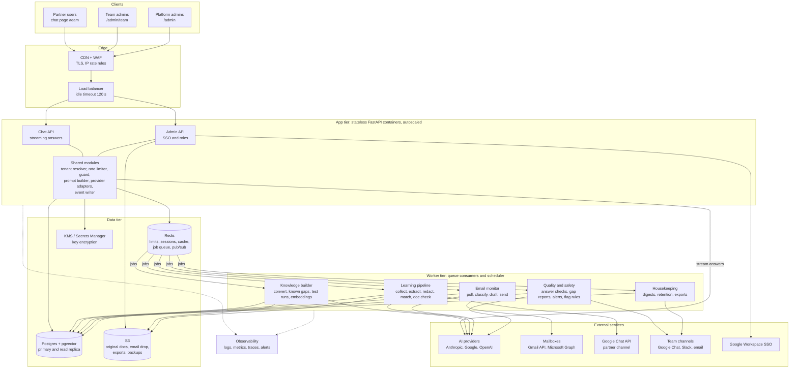

How to read it:

- **Request path (left to right in time):** partner → CDN/WAF → load balancer → Chat API → shared modules (team, limits, guard, prompt) → AI provider, streamed back the same way. The detailed sequence is in [12.3](#123-request-flow).
- **Everything slow or scheduled** (document conversion, embeddings, the learning pipeline, email polling, answer checks, reports) runs in workers fed by the Redis job queue, so chat latency never depends on it.
- **All state** lives in the data tier. App and worker containers keep nothing that can't be rebuilt, so any number of them can run.

### 18.2 Capacity estimate

These are planning assumptions, to be replaced with measured numbers from the DSA pilot.

| | End of v0 (assumed) | 10× growth |
|---|---|---|
| Teams / partners | 10 / 300 | 50 / 3,000 |
| Questions per day | 2,000 | 20,000 |
| Questions per second in the busiest hour (≈15% of the day) | ~0.08 | ~0.8 |
| Answers streaming at the same time (≈20 s each, bursts ×5) | ~2, bursts ~10 | ~17, bursts ~80 |
| Input tokens per question (docs + FAQ, mostly read from cache) | ~25k | ~25k (large packs switch to retrieval) |
| Provider input tokens per minute in the busiest hour | ~125k | ~1.25M |
| Emails processed per day | 500 | 5,000 |
| `events` / `messages` rows per day | 20k / 4k | 200k / 40k |

What this means:

- **The app and database are not the first limit.** Two small app containers handle the v0 load with a lot of headroom; async FastAPI holds hundreds of open streams per container.
- **The first real limits are the AI providers' rate limits (tokens per minute) and cost.** That is why prompt caching, token budgets, per-team keys (which spread load across separate provider accounts), a global concurrency cap and retrieval mode for large packs are part of the design from the start.
- **The next limit is the write volume of `events`** at 10× (about 70M rows a year), handled by monthly partitions and batched inserts.

### 18.3 How each part scales

| Component | Grows with | First bottleneck | How it scales |
|---|---|---|---|
| App containers | Concurrent streams | Open connections and memory per stream | Autoscale on CPU and active connections; minimum 2 for availability |
| Workers | Emails, ingestion, answer checks, reports | Provider throughput | Separate queues: **realtime** (answer checks, alerts, email drafts) and **bulk** (backfill, embeddings, conversion), scaled independently so a backfill never delays an alert. Per-team concurrency caps so one team's backfill can't starve the others |
| Postgres | Events, messages, FAQ and doc embeddings | Event write rate; vector search at large scale | Monthly partitions; batched event inserts; read replica for dashboards and reports; HNSW vector indexes; a dedicated vector store only if chunks pass ~10M |
| Redis | Limit counters, sessions, cache, queue | Memory | Small footprint; managed with a replica; cluster mode if ever needed |
| AI providers | Tokens | Tokens-per-minute limits and cost | Caching (stable layers first, [12.1](#121-what-the-model-receives)); per-team keys; global concurrency cap with a short wait then a "busy, try again" message; retrieval mode; cheaper model per team; batch APIs for bulk work |
| Knowledge cache | Teams × published versions | Memory per instance | In-memory LRU per instance, loaded on demand, cleared on publish via pub/sub |
| S3 | Documents, drops, exports | — | Effectively unlimited; lifecycle rules delete email drops after processing |

### 18.4 Failure handling

| Failure | Effect | Handling |
|---|---|---|
| AI provider outage or overload | Teams on that provider can't get answers | Timeouts, retries with backoff, circuit breaker; clear message in chat; alert to platform admins |
| A team's key is revoked or out of credit | That team's bot can't answer | Clear message to partners, email to team admins; no silent switch to the platform key ([9](#9-architecture-for-scale)) |
| App container crashes | Its in-flight answers are cut off | Load balancer routes to healthy containers; chat page offers retry; the partial answer is logged with stop reason `error` |
| Redis unavailable | Limits and sessions can't be checked | Fail closed: chat shows "busy" instead of running unlimited; managed Redis fails over to its replica |
| Postgres primary fails | Writes fail briefly | Multi-AZ failover (about 1–2 minutes); events are buffered briefly in memory, and any dropped are counted in a metric |
| Worker backlog | Late drafts or reports | Queue-depth alerts; workers autoscale; bulk and realtime queues are separate |
| Bad docs publish | Wrong answers | Test questions run before publish; one-click rollback; every answer records its knowledge version |
| Wrong FAQ entry gets approved | Wrong answer cited as past Q&A | 👎 and answer check surface it; an admin suspends the entry and republishes in minutes |

### 18.5 Tenant isolation

| Layer | How one team is kept from affecting another |
|---|---|
| Data | `team_id` on every row; one team-scoped data access layer; cross-team tests in CI; Postgres row-level security as a second line of defence |
| Prompts and cache | Cache keys per team and knowledge version; one team's docs or FAQ never enter another team's prompt |
| Keys | Per-team provider keys and mailbox tokens, envelope-encrypted with KMS |
| Load | Per-team rate limits and token budgets; per-team worker concurrency caps (noisy-neighbour protection) |
| Access | Admin roles scoped to teams; partner users scoped to one team's partner |

### 18.6 Cost controls

- Prompt caching on the stable layers, so most input tokens are billed at the cached rate.
- Team token budgets with 80% warnings and a polite pause at 100% ([6.3](#63-rate-limiting)).
- Model and effort chosen per team; a small model for answer checks and classification.
- Batch APIs for the backfill, extraction and other non-urgent bulk work.
- Cost per question, per partner and per team shown in the admin panel, from the token counts recorded on every answer.
